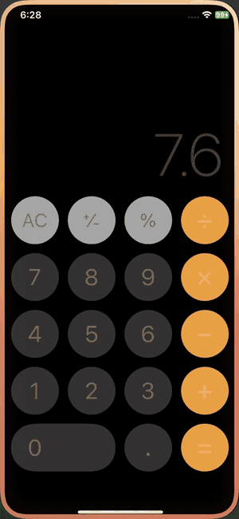
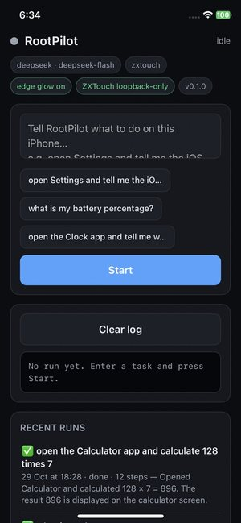
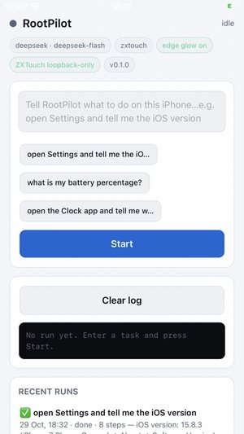
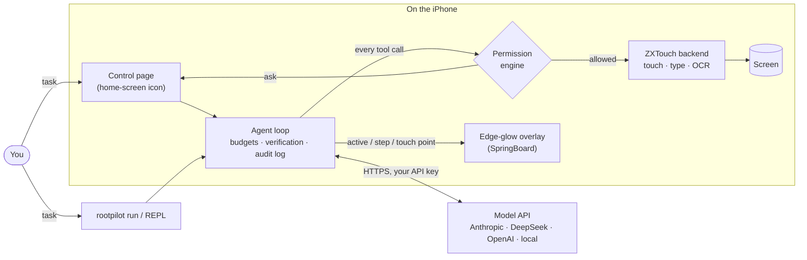

<h1 align="center">RootPilot</h1>

<p align="center">
  <b>An on-device AI agent for jailbroken iPhones.</b><br>
  Tell it what to do in plain language; it reads the screen, taps and types, checks the result,
  and asks you before anything sensitive.
</p>

<p align="center">
  <a href="https://github.com/TZzAp/rootpilot/actions/workflows/ci.yml"></a>
  
  
  
  <a href="LICENSE"></a>
</p>

<p align="center">
  
  &nbsp;
  
  &nbsp;
  
</p>
<p align="center"><sub>
  Left: <i>"open the Calculator app and calculate 128 times 7"</i> on an iPhone X (sped up 3×) —
  the glowing edge means the agent is in control, the ripples show where it taps.
  Middle/right: the control page behind the RootPilot home-screen icon, on an iPhone X and an iPhone 7 Plus.
</sub></p>

---

## What it does

- **Runs on the phone.** A pure-Python, standard-library-only core (Python 3.9+): nothing to
  compile on the device. Works over SSH too.
- **Sees and acts.** Reads the screen (text recognition through ZXTouch), taps, swipes, types,
  opens apps and URLs, and verifies each step before the next.
- **Your model, your key.** Anthropic (default `claude-opus-5-5`), DeepSeek, OpenAI, or any
  OpenAI-compatible server for local models. `rootpilot setup` picks one and stores the key
  (`0600`).
- **Asks before it matters.** Confirmation for irreversible taps (*Send, Pay, Delete, Reset…*),
  for sensitive apps (Wallet, Messages, Mail, banking…) and for shell commands; it never types
  into password fields. Screen text is treated as untrusted data, not instructions.
- **Visible and stoppable.** A home-screen icon opens a control page to start tasks, watch each
  step, answer Allow/Deny prompts, stop a run and browse history. While the agent is in control,
  an orange glow runs around the screen edge.
- **Accountable.** Every run is logged as JSONL with secrets redacted; budgets cap steps, tokens
  and time.

## How it works



Each step: **observe** the screen (as a UI tree with element refs like
`e12 Button "General" @(201,406)`) → the model picks a **tool** (`tap`, `swipe`, `type_text`,
`launch_app`, `done`…) → the **permission engine** allows, asks or denies → RootPilot **acts**
and re-observes so the model can check what changed. See [`SPEC.md`](SPEC.md) for the design.

## Tested devices

| Device | iOS | Jailbreak | Status |
|---|---|---|---|
| iPhone X | 16.7.11 | palera1n (rootful) | ✅ smoke test, control page, edge glow |
| iPhone 7 Plus | 15.8.3 | Dopamine 2 + ElleKit (rootless) | ✅ smoke test, control page, edge glow |

Rootful and rootless jailbreaks are both supported; RootPilot finds the jailbreak root at
runtime and never hardcodes `/var/jb`.

## Quick start

**Try it without a phone** (mock device, deterministic tests):

```bash
git clone https://github.com/TZzAp/rootpilot && cd rootpilot
python3 -m venv .venv && . .venv/bin/activate && pip install -e '.[dev]'
rootpilot doctor --backend mock
pytest -m "not device"
```

**On a jailbroken iPhone** — full guide in [`docs/SETUP.md`](docs/SETUP.md):

```bash
sudo apt install python3 uikittools network-cmds ldid      # Procursus
# install ZXTouch bound to 127.0.0.1 (scripts/zxtouch_loopback.py), then:
rootpilot setup                                            # pick a provider, paste the key
rootpilot doctor                                           # every line should say ok
rootpilot run "open Settings and tell me the iOS version"
rootpilot install-icon                                     # home-screen icon + control page
```

## Commands

| Command | What it does |
|---|---|
| `rootpilot run "<task>"` | Run one task (interactive confirm prompts in a terminal) |
| `rootpilot` | Interactive REPL |
| `rootpilot setup` | Choose a provider (Anthropic, DeepSeek, OpenAI, local) and store its key |
| `rootpilot doctor` | Check Python, config, provider, backend, ZXTouch exposure, control page, overlay |
| `rootpilot serve` | Start the control page on `127.0.0.1` (normally run by launchd) |
| `rootpilot install-icon` | Add (or `--remove`) the RootPilot home-screen icon |
| `rootpilot daemon-plist` | Print the launchd plist that keeps the control page running |
| `rootpilot capture` | Save screen frames through the overlay (docs, debugging) |

## Project layout

```
agent/            the Python core (runs on the phone)
  loop.py           observe → think → act loop, budgets, verification
  permissions.py    allow / ask / deny rules and escalations
  backends/         ZXTouch (device) and mock (tests) backends
  perception/       UI-tree rendering, pure-Python PNG codec
  providers/        Anthropic, DeepSeek, OpenAI, OpenAI-compatible
  tools/            tool definitions shared by the loop (and MCP, planned)
  serve.py webui/   loopback control page and the home-screen web clip
  indicator.py      "agent is in control" signals for the overlay
hud/              SpringBoard edge-glow overlay (Objective-C, built on Linux)
scripts/          ZXTouch loopback/rootless patcher, icon and GIF tools
docs/             setup, security model, configuration
tests/            118+ tests, no network or device needed
```

## Roadmap

| | Milestone | Status |
|---|---|---|
| M0 | Scaffold, ZXTouch backend, smoke test on a device | ✅ done |
| M1 | Permissions, perception, providers, audit log, CLI, docs | ✅ done |
| — | Control page, home-screen icon, edge-glow overlay, rootless support | ✅ done |
| M2 | Native helper daemon (screenshots, HID, buttons, kill-switch chord) | planned |
| M3 | Accessibility-tree perception, tap-by-ref, secure-field detection | planned |
| M4 | `rootpilot mcp` (stdio MCP server); Sign in with ChatGPT | planned |
| M5 | `.deb` packages and an APT repo (rootful, rootless, RootHide) | planned |
| M6 | Record runs as deterministic skills and replay them without a model | planned |

## Security & legal — read this first

- **Jailbreaking is risky.** It weakens iOS security, may void your warranty and may break the
  terms of some apps and services. Only use RootPilot on a device you own.
- **An AI agent can tap anything you can.** RootPilot asks before sensitive or irreversible
  actions, but no permission system is perfect. Don't leave it running unattended in banking,
  payment, messaging or account-settings apps. Stop it any time from the control page, with
  Ctrl-C, or with the stop file.
- **Screen content is untrusted.** A web page, message or notification can contain text that
  tries to steer the agent (prompt injection). RootPilot marks screen content as data, not
  instructions, but you should still review what it does. See [`docs/SECURITY.md`](docs/SECURITY.md).
- **Your API keys, your terms.** You bring your own provider API key and are bound by that
  provider's terms of service and usage policies — and by the terms of any app or site you point
  the agent at. Keys are read from environment variables or a `0600` config file and are
  redacted from logs.
- **No Claude subscription OAuth.** RootPilot does not log in with a Claude.ai / Claude Pro / Max
  subscription, does not reuse Claude Code credentials and never identifies itself as Claude Code.
  Use an Anthropic API key, or use RootPilot from Claude Code as an MCP server (planned, M4).
- **Nothing listens on the network.** The optional control page binds to `127.0.0.1` only and
  needs a secret token. Keep ZXTouch bound to `127.0.0.1` too (see setup docs) — otherwise anyone
  on your Wi-Fi could control your phone.

## Contributing

See [`CONTRIBUTING.md`](CONTRIBUTING.md). Security issues: please report privately, see
[`.github/SECURITY.md`](.github/SECURITY.md).

## License

[Apache-2.0](LICENSE). ZXTouch is a separate project by its author; RootPilot talks to it over
its socket and ships a script to patch your own copy, not the binaries.
